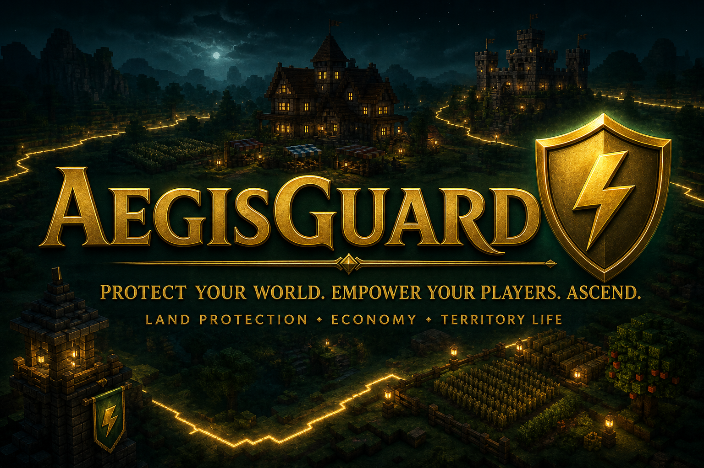

<p align="center">
  
</p>

<h1 align="center">AegisGuard 1.4.5</h1>

<p align="center">
  <strong>Protect your world. Empower your players. Ascend.</strong>
</p>

<p align="center">
  
  
  
  
  <a href="https://discord.gg/nHwdhKzeKR"></a>
  <a href="https://github.com/snazzyatoms/AegisGuard"></a>
</p>

<p align="center">
  <a href="https://github.com/snazzyatoms/AegisGuard/wiki">Wiki</a> &bull;
  <a href="https://discord.gg/nHwdhKzeKR">Discord</a> &bull;
  <a href="https://github.com/snazzyatoms/AegisGuard/issues">Issues</a> &bull;
  <a href="https://github.com/snazzyatoms/AegisGuard/releases">Releases</a>
</p>

---

## A Living Territory System

**AegisGuard** is a Minecraft land-protection plugin that turns claims into a full territory experience. Players secure land, develop plots, manage roles and rentals, run local markets, host events, and pursue long-term progression. Staff get recovery snapshots, migration tools, diagnostics, world controls, and an audit trail for high-impact actions.

It runs on **Paper, Purpur, Spigot, and Folia** with **Java 21+**. **1.4.0** is the current public release; this branch builds **1.4.5**. Existing `1.2.7` and `1.3.x` data and configuration remain valid through automatic schema migration.

> Downloads live on the [1.4.0 GitHub Release](https://github.com/snazzyatoms/AegisGuard/releases/tag/1.4.0) page. This README describes the in-development 1.4.5 line — see [`UPCOMING.md`](aegisguard-modern/UPCOMING.md) for the full roadmap.

## Coming In 1.4.5 — The Hearthstone Update

1.4.0 connected the servers. 1.4.5 protects what makes them home. This point release is about recovery, polish, and finishing the last room of the network.

**Self-backups — your realm can always come home.** `/ag backup` gives plot owners their own restore points: settings, roles, members, and bounds, plus the build itself when WorldEdit/FAWE is present and the server opts in. Owners browse their history and roll back a bad change themselves — or route restores through staff approval, server's choice. Cooldowns, per-plot caps, and an optional Vault cost keep it honest. Griefed at 2 AM? It's a fix, not a ticket.

**Party up — your crew, on screen.** `/ag party` forms a group for a dungeon run, a build session, or just wandering — and every member shows on a live sidebar roster: health, a star on the leader, offline friends greyed. Wynncraft-style, zero setup, and arena-run groups ride the same sidebar automatically.

**Arenas feel like events.** A live match HUD (wave counter, run timer, party status), configurable per-preset rewards (Vault, XP, or items), parties that persist between runs, and a per-arena record board — fastest clears, most waves, top parties.

**Caravans run both ways.** Return deliveries bring payment home, a shipment ledger tab lands in the caravan GUI, and owners set per-route pricing and cargo limits on their own beacon links.

**The radio is complete.** The 1.4.0 flagship gets its last room: `/ag chat` plot frequencies relay to members on other backends — your plot's channel follows your people wherever they're logged in on the network. Same rules, wider range: one channel per player, member-only, identical on Java and Bedrock. And like everything in the network stack, it fails closed — a single server behaves exactly as it does today.

## What 1.4.0 Shipped

The current public release turned protected land into a full territory platform: the Travel Atlas, instanced Arena Dungeons on your own maps, trade caravans, Guardian Succession, plot and alliance radios, Hearth rooms, the ClaimBlocks exchange, sanctuary settings — and the flagship — one AegisGuard network spanning BungeeCord/Velocity proxies with shared discovery, rosters, beacons, and arenas. Full notes on the [1.4.0 release](https://github.com/snazzyatoms/AegisGuard/releases/tag/1.4.0) and [Release Highlights](wiki/Release-Highlights.md) pages.

## Core Systems

| System | Capabilities |
|---|---|
| Protection | Claims, server zones, sub-zones, interactions, containers, entities, vehicles, hostile-mob controls, lockdown, hopper/liquid/teleport/storm/mob-griefing/interactables wards, potion and entity-placement filtering, and boundary enforcement |
| Progression | Plot Ascension, utility disciplines, Frontier Expansion, Expansion Horizons, Renown, and Sigils |
| Economy | ClaimBlocks with buy/sell exchange and ledger, Vault support, real-estate listings, auctions, local markets, TradeStalls, GiftBlocks, and rentals |
| Community | Roles, locked members, Guest Passes, Alliance Access, group plots, Realm Profiles, noticeboards, Safe Travel, Teleport Beacons, Travel Atlas, Guardian Succession, trade caravans, open-house gatherings, Aegis Frequency radios, Hearth text-chat rooms, and an optional Simple Voice Chat hook |
| Arenas | Optional party dungeons on bound server plots — PvE waves, boss finales, opt-in PvP, custom floors and schematics, staging hubs, matchmaking queues, sealed runs, and Folia-safe scheduling |
| Administration | Doctor tools, recovery snapshots, restoration, migration, Audit Ledger, `/agadmin health`, `/agadmin inspect`, grief-attempt alerts, staff seasons and flight skills, diagnostics, world controls, bypass tools, convert-to-server, and activity history |
| Modularity | `modules:` switchboard — optional systems default **on** except wilderness revert (**off**, SQL-only); menus hide disabled modules |
| Localization | Direct language picker across nine packs with synced Codex fallbacks; console output stays plain English |

## Compatibility

| Requirement | Support |
|---|---|
| Minecraft | `1.20+` |
| Java | `21+` |
| Platforms | Spigot, Paper, Purpur, Folia, and compatible Bukkit server forks |
| Economy | Vault with a supported economy provider |
| Networks | BungeeCord or Velocity for cross-server travel, remote arenas, and broadcasts |
| Maps | Dynmap, BlueMap, and Pl3xMap integration paths |
| Extensions | PlaceholderAPI, the public AegisGuard API, optional WorldEdit/FAWE plot backups, and an optional Simple Voice Chat hook for Hearth rooms |
| Upgrade path | From AegisGuard `1.2.7` or `1.3.x` with automatic config schema migration (`config_schema` → `1316`) |

Server implementations evolve independently. Test new Minecraft server releases in a staging environment before updating a public server.

## Installation

1. Stop the Minecraft server.
2. Confirm the host is running **Java 21 or newer**.
3. Place `AegisGuard-1.4.0.jar` in the server's `plugins` directory.
4. Install Vault and an economy provider if money-based features are required.
5. Start the server. On a JAR swap from 1.2.7 or 1.3.x, config and language merge run automatically and existing plots load as-is.
6. Review `plugins/AegisGuard/config.yml` and the files under `plugins/AegisGuard/lang/`.
7. Confirm status with `/agadmin transition` (aliases `upgrade`, `v130`, `v140`). A folder backup of `plugins/AegisGuard/` is recommended, not required to keep claims.
8. Run `/agadmin doctor` only if something looks wrong.

Do not use Bukkit's global `/reload` command. Use `/agadmin reload` for supported AegisGuard configuration and language reloads, and perform a full restart after changing integrations or storage settings.

## Quick Start

```text
/ag wand                     Get the Aegis Scepter
/ag claim                    Create a claim from the current selection
/ag quickclaim [radius]      Claim a square around you, no wand needed
/ag menu                     Open the territory dashboard
/ag travel                   Open the Travel Hub
/ag visit                    Open the Travel Atlas
/ag beacon                   Manage Teleport Beacons
/ag arena                    Browse, join, and party for arena runs
/ag caravan                  Dispatch and track trade caravans
/ag gathering                Host or browse open-house gatherings
/ag chat                     Toggle plot chat (alliance and group radios available)
/ag blocks buy|sell          Trade ClaimBlocks through the exchange
/ag guide                    Replay the first-claim walkthrough

/agadmin menu                Open the Staff Command Center
/agadmin transition          Confirm upgrade status from 1.2.7 or 1.3.x
/agadmin reload              Reload editable settings and languages
```

See the [Wiki](https://github.com/snazzyatoms/AegisGuard/wiki) for detailed commands, permissions, configuration, economy, migration, and player guides.

## Repository Layout

| Place | What it is |
|---|---|
| [`1.4.5`](https://github.com/snazzyatoms/AegisGuard/tree/1.4.5) | Next point release — The Hearthstone Update, in development |
| [`V1.4.0`](https://github.com/snazzyatoms/AegisGuard/tree/V1.4.0) | Current release line — GitHub Release **1.4.0** |
| [`V1.3.5`](https://github.com/snazzyatoms/AegisGuard/tree/V1.3.5) | Previous public line — GitHub Release **1.3.5** |
| [`V1.3.0`](https://github.com/snazzyatoms/AegisGuard/tree/V1.3.0) | Earlier public 1.3.0 line |
| [`aegisguard-modern/`](aegisguard-modern/) | Plugin source (Maven, Java 21) |
| [`examples/api-addon/`](examples/api-addon/) | Example plugin that compiles against the public API |
| [`wiki/`](wiki/) | Pages to paste into the GitHub Wiki |
| [`listing/`](listing/) | Spigot/CurseForge listing art |
| [`media/`](media/) | Showcase GIFs hotlinked by the listing pages |
| [`aegisguard-modern/UPCOMING.md`](aegisguard-modern/UPCOMING.md) | Roadmap beyond the current line |

## For Developers

`AegisGuard-1.4.0-api.jar` ships with each [release](https://github.com/snazzyatoms/AegisGuard/releases/tag/1.4.0) as a compile-time dependency — it does not belong in a server's `plugins` folder. Public events and service accessors live under `com.aegisguard.api` with Javadocs.

---

<p align="center">
  <strong>Simple. Steadfast. Eternal.</strong><br />
  Forged by Aegis Divine.
</p>
